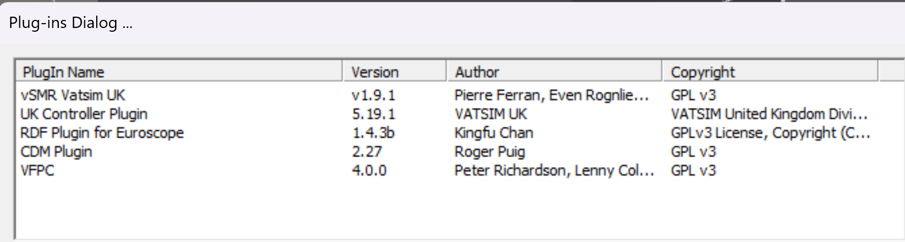
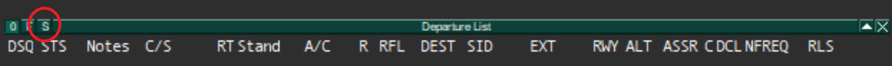
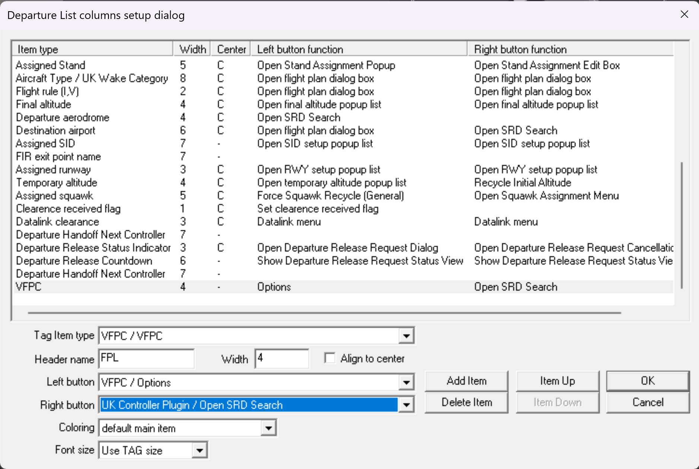

# Installation and Configuration

This guide explains how to install the vFPC plugin into EuroScope and configure it for use. The process only needs to be completed once.

## Download

vFPC is no longer included with the VATSIM UK Controller Pack.

Download the latest version from the
[GitHub Releases](https://github.com/VFPC/VFPC-next/releases/latest) page.

After downloading `VFPC.dll` move it to the folder `%APPDATA%\EuroScope\UK\Data\Plugin\VFPC\`.

The plugin will work from any location, but the above path is the recommended location for consistency with other EuroScope plugins.

!!! note
    vFPC stores its configuration and data files using the standard Windows
    Application Data folders. These locations are determined automatically by Windows and no configuration is normally required.
    
    For more information about **%APPDATA%** and **%LOCALAPPDATA%** folders see the Microsoft documentation:

    - 🔗 [Microsoft Learn - KnownFolder IDs](https://learn.microsoft.com/windows/win32/shell/knownfolderid)

## Plugin Configuration

Before you use the plugin it needs to be configured within EuroScope as follows:

!!! note "Allow Draw on Types"
    The plugin does not require **Allowed To Draw On Types** to function.
    Please **DO NOT** alter these settings.

### Load the plugin

1. Start EuroScope and open the required profile (`.prf`).
2. From the menu bar, select **Other Set → Plug-ins**.
3. From the Plug-ins Dialog, click the **Load** button and navigate to the folder where you moved `VFPC.dll`.
4. Select `VFPC.dll` and click **Open**.
5. `VFPC.dll` should now appear in the list as shown below.
   
    {.vfpc-screenshot}

    *Figure 1: EuroScope Plugin Dialog List.*{.vfpc-caption}

## Departure List Configuration

The final part of configuration is to add a column to the Departure List which is used to display the validation results.

### Add the vFPC column

1. Click **S** in the top left of your departure list to open the 'Departure list columns setup dialog'.

    {.vfpc-screenshot .vfpc-screenshot--wide}

    *Figure 2: Departure list menu.*{.vfpc-caption}

2. Click **Add Item**. A new item named **Callsign** is added to the bottom of the list.
3. Select the new item and change **Tag Item Type** to **VFPC/VFPC**.
4. Set **Header name** to **FPL**, **Width** to **4**, and leave **Align to center** unchecked.

### Configure mouse actions

1. Set **Left button** to **VFPC / Options**.
2. Set **Right button** to **UK Controller Plugin / Open SRD Search**.
3. The Departure List columns setup dialog should now look similar to Figure 3.

    {.vfpc-screenshot .vfpc-screenshot--wide}

    *Figure 3: Departure list columns setup*{.vfpc-caption}

The vFPC plugin is now configured and ready for use.

!!! tip "FPL Column Position"
    You can move the position that the FPL column appears on the Departure List by using the 'Item Up' and 'Item Down' buttons.

## Updating vFPC

New versions of vFPC are published on the
[GitHub Releases](https://github.com/VFPC/VFPC-next/releases/latest) page.

To update vFPC:

1. Close EuroScope.
2. Download the latest version of `VFPC.dll`.
3. Replace the existing `VFPC.dll` in your vFPC plugin folder with the new version.
4. Restart EuroScope.

Your existing Departure List configuration does not normally need to be
changed when updating vFPC.

!!! note
    Release notes are provided with each release and should be reviewed
    for any additional installation or configuration requirements.