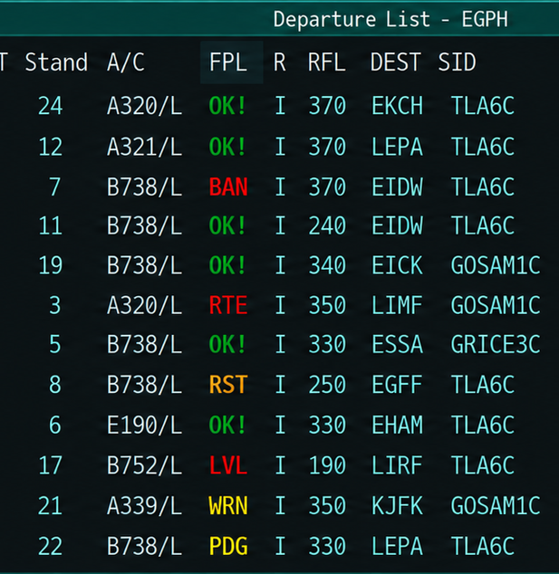
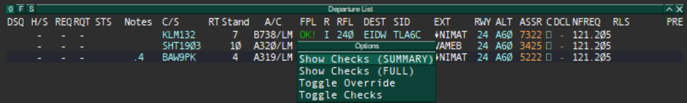

# Using vFPC

Once installed and configured, vFPC operates automatically while you are
controlling. Validation results are displayed in the **FPL** column of the
EuroScope Departure List.

## Normal Operation

vFPC validates IFR departure flight plans for the active departure airport
using the currently loaded validation data.

A flight plan is normally validated when:

- A new IFR flight plan is detected.
- A relevant part of an existing flight plan is changed.
- Updated validation data is loaded.

VFR flight plans are not validated.

!!! note
    vFPC requires a departure runway to be assigned before flight plan
    validation can take place.

## The FPL Column

The **FPL** column within the Departure List displays a short code indicating the current validation result.

{.vfpc-screenshot .vfpc-screenshot--50percent}

*Figure 5: vFPC validation results in the EuroScope Departure List.*{ .vfpc-caption }

For example:

- OK! — the flight plan passed validation.
- WRN — advisory information is available.
- RTE — the route requires attention.
- PDG — validation is pending.
- VFR — the flight plan is VFR and is not validated.
- OFF — validation has been disabled for the flight plan.
- OVR — a controller override has been applied.

The code is intended to provide a quick indication only. See the
[Validation Reference](validation-results.md) for a full explanation of
each result.

## Using the FPL Column

The **FPL** column is also used to access vFPC functions.

### Left-click — vFPC Options

Left-click the **FPL** result for a flight plan to open the vFPC options menu.

As shown in **Figure 6**, the menu provides four options:

- **Show Checks (SUMMARY)**
- **Show Checks (FULL)**
- **Toggle Override**
- **Toggle Checks**

The purpose and use of each option are described in the following sections.

{ .vfpc-screenshot .vfpc-screenshot--wide }

*Figure 6: vFPC options available from the Departure List.*{ .vfpc-caption }

### Right-click — SRD Search

Right-click the **FPL** result to open **SRD Search** using the UK Controller
Plugin.

This provides quick access to the applicable Standard Route Document
information when reviewing a flight plan.

## Viewing Validation Results

More detailed information about a validation result can be displayed in the
EuroScope message window by selecting **Show Checks (SUMMARY)** or
**Show Checks (FULL)** from the menu shown in **Figure 6**.

### Show Checks (SUMMARY)

**SUMMARY** displays the principal validation result together with a short
explanation. This will normally provide sufficient information to understand
why a flight plan has not validated successfully.

### Show Checks (FULL)

**FULL** displays the individual checks performed by vFPC and their results.
Use this when more detail is required or when investigating an unexpected
validation result.

!!! note
    Validation details are displayed in the EuroScope message window only
    when **Show Checks (SUMMARY)** or **Show Checks (FULL)** is selected.

## Toggle Override

**Toggle Override** allows the controller to override the validation status displayed in the **FPL** column.

An override does not change the filed flight plan or the underlying validation result. The **FPL** column displays **OVR** to indicate that a controller override has been applied.

Select **Toggle Override** again to remove the override.

## Toggle Checks

**Toggle Checks** disables validation for the selected flight plan. The
**FPL** column displays **OFF** while validation is disabled.

Select **Toggle Checks** again to re-enable validation.

This can be useful where vFPC validation is not appropriate for a particular
flight plan.

## When a Flight Plan Does Not Validate

A result other than **OK!** does not necessarily mean that the flight plan
should simply be rejected or changed.

1. Review the code displayed in the **FPL** column.
2. Select **Show Checks (SUMMARY)** to view the reason.
3. If further information is required, select **Show Checks (FULL)**.
4. Compare the result with the applicable procedures and current flight plan.
5. Take the appropriate controller action.

If vFPC does not behave as expected, see
[Troubleshooting and Limitations](troubleshooting.md).

!!! warning "Controller Responsibility"
    vFPC is a controller aid. Validation results should be considered alongside
    current procedures and the controller's own assessment of the flight plan.