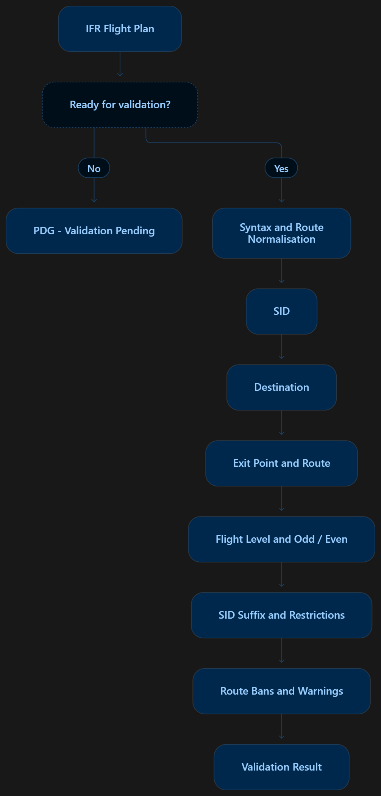

# Validation Reference

vFPC displays a short validation code in the **FPL** column of the EuroScope
Departure List. The code provides a quick indication of the validation status
of the flight plan.

This page explains the validation colours and result codes used by vFPC.
For information about viewing Summary and Full validation results, see
[Using vFPC](using-vfpc.md).

## How Validation Works

When an IFR flight plan is ready for validation, vFPC checks the filed
information against the data available for the departure airport.

The diagram below provides a simplified overview of the validation process.
Individual checks may depend on the results of earlier checks.

{.vfpc-screenshot .vfpc-screenshot--50percent}

*Figure 7: Simplified vFPC validation process.*{.vfpc-caption}

The validation data is primarily generated from the NATS Standard Route Document (SRD) and may also include airport-specific operational rules and local procedures.

## Result Colours

The colour of the FPL column provides the quickest indication of the validation status.

| Colour    | Meaning                                                                                          |
| --------- | ------------------------------------------------------------------------------------------------ |
| Green | Flight plan validated successfully. |
| Yellow | Validation is pending or advisory information is available. |
| Amber | Flight plan contains a level, odd/even or suffix issue that should be reviewed. |
| Red | Validation failure. Controller action required. |
| Grey | Flight plan is not currently being validated (for example VFR traffic or validation disabled). |
| Cyan | Controller override has been applied. |

!!! note
    The exact colours used are configurable within the vFPC configuration file. The colours shown above represent the default behaviour.

## Result Codes

The following table provides a quick reference to the result codes displayed
in the **FPL** column. More detailed information about each result is provided
below.

| Code | Meaning |
| --- | --- |
| OK! | All validation checks passed |
| WRN | Advisory information is available |
| PDG | Validation is pending |
| VFR | VFR flight plan — not validated |
| OFF | Validation has been disabled for the flight plan |
| OVR | Controller override applied |
| SID | SID validation failed |
| DST | Destination validation failed |
| XIT | Exit-point validation failed |
| RTE | Route validation failed |
| LVL | Flight-level validation failed |
| OER | Odd/even flight level validation failed |
| SFX | SID suffix validation failed |
| RST / RST | SID or route restriction requires attention |
| BAN | Applicable route or SID ban triggered |
| SYN | Flight plan syntax validation failed |
| ERR | Error encountered during validation |

---

OK! indicates that all applicable
validation checks have passed.

No further vFPC action is required.

---

WRN indicates that the flight
plan has passed validation, but advisory information is available.

Review the Summary result for details of the warning.

---

PDG indicates that validation
is pending.

This is normally a temporary condition while vFPC is waiting for information
required to validate the flight plan, for example:

- Airport validation data is still loading.
- A departure runway has not yet been assigned.

Validation will proceed when the required information becomes available.

---

VFR indicates that the flight
plan is VFR.

vFPC validates IFR departure flight plans only. VFR flight plans are therefore
not validated.

---

OFF indicates that validation
checks have been disabled for the flight plan using **Toggle Checks**.

Select **Toggle Checks** again to re-enable validation.

---

OVR indicates that the controller
has applied an override to the validation status displayed in the **FPL**
column using **Toggle Override**.

The override does not change the filed flight plan or the underlying
validation result.

Select **Toggle Override** again to remove the override.

---

SID indicates that the flight
plan has failed SID validation.

Review the Summary result for details of the SID validation failure.

---

DST indicates that the destination
has failed validation against the applicable route requirements.

Review the Summary result for details of the destination validation failure.

---

XIT indicates that the exit point
has failed validation against the applicable route requirements.

Review the Summary result for details of the exit point validation failure.

---

RTE indicates that the filed route
has failed validation against the applicable route requirements.

Review the Summary result for details of the route validation failure.

---

LVL indicates that the requested
flight level has failed validation against the requirements for
the applicable route.

Review the Summary result for details of the flight level validation failure.

---

OER indicates that the requested
flight level has failed the odd/even flight level requirements for
the applicable route.

Review the Summary result for details of the odd/even validation failure.

---

SFX indicates that the SID suffix
has failed validation against the requirements for the applicable route.

Review the Summary result for details of the SID suffix validation failure.

---

RST or
RST indicates that a SID or route
restriction applies to the flight plan.

- Red indicates that the restriction
  has caused validation to fail.
- Amber indicates that the
  restriction is advisory.

Review the Summary result for details of the applicable restriction.

---

BAN indicates that the flight plan
has triggered an applicable route or SID ban.

Review the Summary result for details of the applicable ban.

---

SYN indicates that the flight plan
has failed syntax validation.

Review the Summary result for details of the syntax validation failure.

---

ERR indicates that vFPC encountered
an error while attempting to validate the flight plan.

Review the Summary result for further information. If the cause is not clear,
refer to [Troubleshooting and Limitations](troubleshooting.md).

!!! warning "Controller Responsibility"
    vFPC is an advisory validation tool designed to assist controllers.

    Controllers remain responsible for applying current procedures, local
    instructions, SRD requirements, SID restrictions, level capping
    requirements and the semicircular rule.

    An **OK!** result should not be used as a substitute for operational
    knowledge and judgement.
