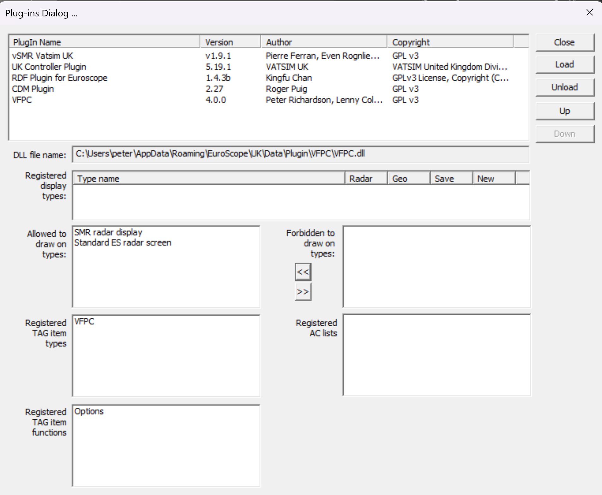

# Installation and Configuration.

## Download.
vFPC is no longer included within the UK Controller Pack.  It can only be downloaded from You can find it 🔗 [here](https://github.com/VFPC/VFPC/releases/latest){ target="_blank" }.

Once you have downloaded `vfpc.dll` it is recommended that you move it to the folder `%APPDATA%\EuroScope\UK\Data\Plugin\VFPC\`.

## Plugin Configuration.
Before you use the plugin it needs to be configured within EuroScopeas follows:

1. Start the EuroScope Application (You will need to select a profile file. [.prf]).
2. From the menu bar, select **`Other Set -> Plug-ins`.**
3. From the Plug-ins Dialog, click the **`Load`** button and navigate to the folder where you moved `vfpc.dll`.
4. Select `vfpc.dll` and click **`Open`**.
5. `vfpc.dll` should now appear in the list as shown below.
   
    

    *Figure 1: EuroScope Plugin Dialog List.*

6. We now need to allow the plugin to draw on the display.  Select `vfpc.dll` within the list on the dialog.
7. Within 'Forbidden to draw on types' select 'Standard ES radar screen'.
8. Click the double left angled brackets **(`<<`)** which moves 'Standard ES radar screen' into the 'Allowed to draw on types' list. 
9. Repeat for 'SMR radar display'.
10. The dialog should now look similar to the following.

    
 
    *Figure 2: EuroScope Plugin Dialog.*

## Departure List Configuration

The final part of configuration is to add a column to the Departure List which is used to display the validation results.

1. Click **`S`** in the top left of your departure list to open the 'Departure list columns setup dialog'.

    

    *Figure 3: Depature list menu.*

2. Click **`Add Item`**. This should add a new item called 'Callsign' to the bottom of the list.
3. Select this, and using the drop-down change the 'Tag Item Type' to 'VFPC/VFPC'.
4. The next line of options changes how the column displays within the departure list. We recommend setting the 'Header name' to 'FPL', 'Width' to 4, and leaving 'Align to center' off (unchecked).
5. Finally, we need to configure the action to be completed on left/right click. Using the dropdowns, set the 'Left button' to 'VFPC (UK) / OPTIONS'
6. Set the 'Right button' to 'UK Controller Plugin / Open SRD Search'.
7. Your Departure List columns setup dialog should look something like this:

    

    *Figure 4: Depature list.*

The vFPC plugin is now configured and ready for use.

!!!tip "Tip"
    You can move the position that the FPL colum appears on the Departure List by using the 'Item Up' and 'Item Down' buttons.
